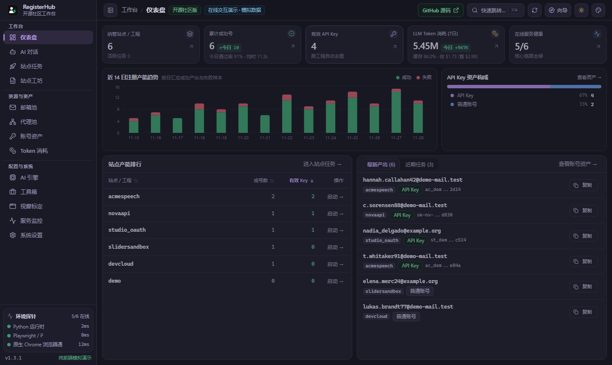
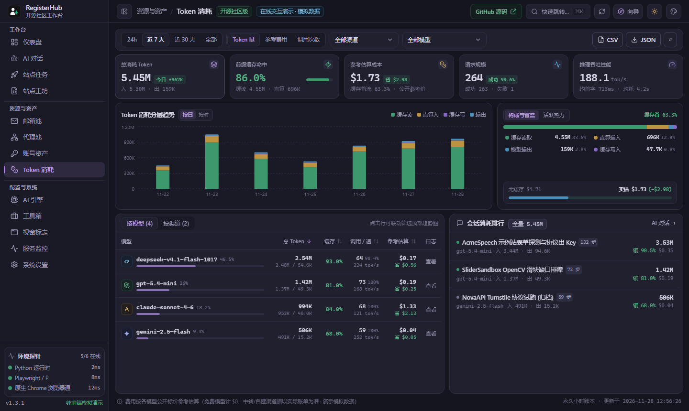
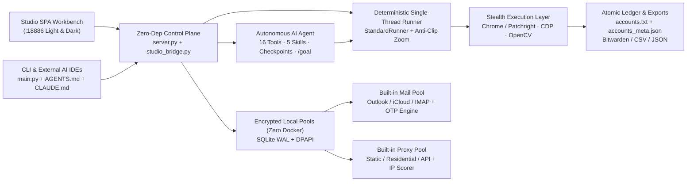

<h1 align="center">RegisterHub</h1>

<p align="center">
  <b>Zero-Dependency Studio Workbench · Autonomous Streaming AI Agent · Universal Account Automation Framework</b><br>
  <i>Built with pure Python stdlib HTTP/SSE, Playwright/Patchright runtime parity, encrypted built-in Mail & Proxy pools, and an autonomous 16-tool AI Agent.</i>
</p>

<p align="center">
  <a href="LICENSE"></a>
  <a href="DISCLAIMER.md"></a>
  <a href="https://www.python.org/"></a>
  <a href="https://playwright.dev/"></a>
  <a href="tests/"></a>
  <a href="CHANGELOG.md"></a>
  <a href="https://waw666waw666.github.io/registerhub-demo/"></a>
  <a href="#community--support"></a>
  <a href="https://discord.gg/USnVJ9YQX"></a>
</p>

<p align="center">
  <a href="./README.md">简体中文</a> |
  <a href="./README_EN.md">English</a> |
  <a href="./CHANGELOG.md">Changelog</a> |
  <a href="https://waw666waw666.github.io/registerhub-demo/">Live Interactive Demo</a> |
  <a href="#community-vs-pro-edition-open-core">Community vs Pro</a> |
  <a href="#community--support">Community</a>
</p>

<p align="center">
  <a href="https://waw666waw666.github.io/registerhub-demo/">
    
  </a>
</p>

---

## Why RegisterHub?

Most automation scripts stop at fragile headless snippets tied to a single website or demand heavy Docker/cloud stacks. **RegisterHub Community Edition** ships a complete, deterministic engineering workbench powered by **zero external server dependencies (no Docker, no Node.js, pure Python stdlib)**:

- **Zero-Dependency Desktop-Grade Studio Workbench**: Run `python main.py --web --open` (or double-click `run_web.bat` / `./run_web.sh`) to auto-launch the full Studio UI (`http://127.0.0.1:18886`) once `/health` returns 200, with 1-click Light/Dark mode, multi-palette themes, 6-color frosted glass window calibration, live SSE logs, and blackbox failure snapshots.
- **Standalone Single-Viewport Token Usage Dashboard (`/usage`) & Permanent Hourly Ledger**:
  - Top-level sidebar entry locked to zero outer scroll on desktop, supporting `24h / 7d / 30d / All`, `Daily / Hourly`, `Tokens / Est. Cost / Calls`, and cross-filtering by provider/model;
  - Stacked bar trends (cache read / uncached input / cache write / output), cache savings breakdown, **12-week GitHub-style activity heatmap**, model/provider/session leaderboards, 1-click jump to filtered call logs, and CSV / JSON export;
  - Backed by an atomic cross-process permanent hourly ledger (`results/llm_usage_hourly.json`) with incremental JSONL cursor backfill, plus a live 7-day LLM Token KPI card on the Dashboard.
- **Autonomous 3-Protocol Streaming AI Agent**:
  - Real SSE streaming across **OpenAI Chat / Anthropic Messages / OpenAI Responses** with append-only **Prompt Cache prefix stability**, **vendor-adaptive thinking effort controls & 1-click capability probing** (GPT-5 / Claude / Gemini / DeepSeek / Qwen / GLM), live `Cache Hit % / TTFT / tok/s` telemetry, and automatic 85% context compaction;
  - Equipped with **16 engineering tools** (`probe_url`, `analyze_har`, AST-validated `write_adapter` / `patch_adapter`, `run_adapter_once`, `read_failures`, built-in mail/proxy pool control, `verify_accounts`), **5 editable Markdown skills** (`skills/*.md`), step-level code checkpoints with 1-click rollback, **redacted Handoff share & import**, per-channel credential export, persistent guard approvals, `/goal` autonomous loops, and non-blocking streaming `/btw` side questions;
  - Strictly enforces **`AGENTS.md` Protocol-First Escalation (Pure Protocol ➔ Headless ➔ Hybrid Captcha Bridge)** and concise structured reporting.
- **Built-in Encrypted Mail Pool & Proxy Pool (Zero Docker)**:
  - **Built-in Mail Pool**: Local SQLite WAL + Windows DPAPI encryption supporting bulk mixed import of **Outlook OAuth2 (Graph API / IMAP-XOAUTH2)**, **iCloud verification links**, and standard IMAP, paired with an **industrial-grade self-contained OTP extractor** (confidence scoring + street/zip/footer noise rejection) and live inbox inspection;
  - **Built-in Proxy Pool**: Supports bulk static HTTP/HTTPS/SOCKS5 proxies, residential Sticky Session gateways (Smartproxy / IPRoyal / Oxylabs), and short-lived API extract feeds with full-pool probing, target-site 403/CF verification, and **S/A/B/C/D IP purity scoring**.
- **Runtime Environment Parity + Offline CV + CDP Bridge**: Native Chrome (`channel="chrome"`) with optional zero-`Runtime.enable` **`patchright`** auto-acceleration; offline dual-pass Canny OpenCV slider solver with cubic Bezier human kinetics; seamless CDP attach to AdsPower, BitBrowser, or local Chrome.
- **Native AI IDE Contracts**: Ships with [AGENTS.md](AGENTS.md), [CLAUDE.md](CLAUDE.md), and [SETUP_FOR_AI.md](SETUP_FOR_AI.md) so Cursor, Claude Code, Windsurf, and Gemini CLI can auto-bootstrap environments and assemble verified adapters in one prompt.

---

## Visual Tour

> All screenshots below are captured from our pure-mock interactive demo—zero real credentials exposed. [**Try the Live Interactive Demo (Zero Install)**](https://waw666waw666.github.io/registerhub-demo/)

<table>
  <tr>
    <td width="50%">
      
      <p align="center"><b>Dashboard Overview (Dark)</b>: KPIs (with 7d LLM Token card), 14-day throughput chart & Key breakdown</p>
    </td>
    <td width="50%">
      
      <p align="center"><b>Standalone Token Usage Dashboard (`/usage`)</b>: Stacked trends, cache savings, 12-week heatmap & rankings</p>
    </td>
  </tr>
  <tr>
    <td width="50%">
      
      <p align="center"><b>Autonomous AI Agent</b>: Probe ➔ Write Adapter ➔ Trial Run with adaptive thinking effort & live telemetry</p>
    </td>
    <td width="50%">
      
      <p align="center"><b>Site Fleet Tasks (Light)</b>: Per-site attribution, Key (N) shortcut, file explorer reveal & single-thread runs</p>
    </td>
  </tr>
  <tr>
    <td width="50%">
      
      <p align="center"><b>Built-in Mail Pool + Live Inbox OTP</b>: Outlook / iCloud / IMAP management & 1-click OTP copy</p>
    </td>
    <td width="50%">
      
      <p align="center"><b>Built-in Proxy Pool + IP Scoring</b>: Static / Residential Gateways / API feeds & S/A purity grading</p>
    </td>
  </tr>
</table>

---

## 30-Second Quickstart

### Option A: One-Sentence Auto-Bootstrap via Your AI IDE (Recommended)

Clone the repository, open `RegisterHub` in **Cursor / Claude Code / Windsurf / Gemini CLI**, and send:

```text
@SETUP_FOR_AI.md Follow this protocol to probe my host environment, install dependencies, configure config.json, and verify tests + demo.
```

### Option B: Launch the Zero-Dependency Web Workbench

```bash
# 1. Clone and install Python dependencies
git clone https://github.com/waw666waw666/RegisterHub.git
cd RegisterHub
pip install -r requirements.txt

# 2. Install Playwright browser binaries (optional: `pip install patchright` for zero-Runtime.enable stealth)
playwright install chromium

# 3. Start Web Workbench (auto-opens browser once /health is ready; or double-click run_web.bat on Windows)
python main.py --web --open
# Or open http://127.0.0.1:18886 manually
```

### Option C: 3-Second Offline Verification (No Network Needed)

```bash
python main.py doctor       # Executable diagnostics (Python / OpenCV / Chrome / FS)
python main.py --run demo   # 3s offline target verification -> results/accounts.txt
```

---

## Architecture



<details>
<summary><b>Expand repository layout</b></summary>

```text
RegisterHub/
├── core/
│   ├── adapter.py         # BaseSiteAdapter contract & lifecycle hooks
│   ├── ai_agent.py        # Pure-stdlib autonomous single-thread AI Agent (16 tools)
│   ├── llm_client.py      # 3-protocol SSE streaming client + Cache/TTFT/tok_s telemetry
│   ├── llm_context.py     # Multi-vendor context window & adaptive thinking capability engine
│   ├── llm_profiles.py    # Multi-provider & multi-key profile manager
│   ├── llm_usage.py       # Permanent hourly Token ledger (JsonHourlyUsageStore), cursor backfill & cost estimator
│   ├── session_handoff.py # Redacted session Handoff export & import parser
│   ├── mail_builtin.py    # Zero-Docker built-in mail pool (SQLite WAL + DPAPI + OTP extractor)
│   ├── proxy_builtin.py   # Zero-dep built-in proxy pool (Static / Residential / API feeds)
│   ├── ip_scorer.py       # Exit IP residential attribution & risk purity scorer
│   ├── runner.py          # Single-thread runner, proxy resolver, snapshots & per-site attribution
│   ├── pilot.py           # Human-kinetic typing & resilient interaction guards
│   ├── stealth.py         # Native Chrome / Patchright parity & CDP bridge
│   ├── inspector.py       # Heuristic DOM form inspector
│   ├── solver.py          # Offline OpenCV Canny puzzle solver & Bezier trajectory planner
│   ├── identity.py        # High-entropy realistic multi-locale identity generator
│   ├── mail_client.py     # Multi-provider free disposable mailbox client
│   ├── imap_mail.py       # Stdlib single IMAP & BuiltinPoolMailClient
│   ├── calibrator.py      # Cross-resolution symmetric window presets & anti-clipping zoom
│   ├── locks.py           # Cross-process exclusive file locks & atomic writes
│   ├── secrets.py         # Windows DPAPI secret storage & log redaction
│   ├── net_guard.py       # SSRF public-URL validator
│   ├── doctor.py          # Executable environment diagnostics
│   ├── scaffold.py        # Target DOM pre-inspection & adapter scaffold generator
│   └── exporter.py        # Bitwarden, 1Password, CSV & JSON credential exporter
├── skills/                # 5 editable AI Agent engineering skills (*.md)
├── sites/                 # Clean reference adapters (_template / demo_site / automation_exercise)
├── web/                   # Stdlib HTTP/SSE backend (server.py / studio_bridge.py) & SPA bundle (dist/)
├── docs/                  # Window calibration guide & UI screenshots
├── tests/                 # 72 automated unit & regression tests
├── CHANGELOG.md           # Release history & version changelog
├── AGENTS.md              # Agentic engineering contract & reporting format
├── CLAUDE.md              # Claude Code auto-load instructions
├── SETUP_FOR_AI.md        # One-sentence AI bootstrap protocol
├── main.py                # Unified CLI & Web entry point
└── run_web.bat / run.bat  # Windows 1-click launchers (CRLF)
```

</details>

---

## AI Co-Development Workflows

- **Built-in Web AI Agent**: Configure any OpenAI / Anthropic compatible provider under **AI Engine**, paste a signup URL into **AI Chat** (optionally enable **`/goal`**), and watch the agent plan ➔ probe ➔ prefer pure HTTP protocol ➔ AST-validate & write `sites/<name>.py` ➔ run single-thread verification ➔ audit failures & credentials end-to-end.
- **External AI IDEs (Cursor / Claude Code / Windsurf / Gemini)**: Root [AGENTS.md](AGENTS.md) and [CLAUDE.md](CLAUDE.md) load automatically. For complex multi-step SPAs, register once manually and share your exact steps/screenshots with the AI for deterministic first-shot accuracy.

---

## Reference Adapters & Official Standalone Derived Projects

`RegisterHub` ships clean with zero hardcoded commercial sites (`demo`, `automation_exercise`, `_template`). Production workflow implementations live in 5 decoupled, 100% self-contained open-source repositories:

| Standalone Project | Architecture & Highlights | Repository |
| :--- | :--- | :--- |
| **[TokenHarbor Register](https://github.com/waw666waw666/tokenharbor-register)** | **100% Pure Protocol (Zero Browser)** · Next.js Server Action self-healing IDs + Tempmail/IMAP OTP + `:free` consent unlock & live `thk_live_` verification | [GitHub](https://github.com/waw666waw666/tokenharbor-register) |
| **[Deepgram Register](https://github.com/waw666waw666/deepgram-register)** | Official **$200 USD Free Credits** · reCAPTCHA v2 clearance + pure REST 40-char API key minting | [GitHub](https://github.com/waw666waw666/deepgram-register) |
| **[100MilionSeek Register](https://github.com/waw666waw666/100milionseek-register)** | **100M Tokens/day Free Allowance** · Turnstile clearance + instant on-page key extraction + referral loop | [GitHub](https://github.com/waw666waw666/100milionseek-register) |
| **[AMD AI Dev Register](https://github.com/waw666waw666/amd-register)** | Official AMD AI Developer Program · Akamai telemetry parity + OneTrust modal clearance | [GitHub](https://github.com/waw666waw666/amd-register) |
| **[Coarena Register](https://github.com/waw666waw666/coarena-register)** | **Post-OAuth Pure REST Key Minting** · Session capture + pure protocol terms acceptance & quota check | [GitHub](https://github.com/waw666waw666/coarena-register) |

---

## Community vs Pro Edition (Open-Core)

The open-source Community Edition includes the full zero-dependency Studio UI, autonomous streaming AI Agent, and encrypted built-in Mail & Proxy pools—**100% free for personal research and single-thread workflows**. For high-throughput multi-concurrency, unattended scheduling, and team operations, check **AutoRegister Pro**:

| Capability | RegisterHub Community (Apache 2.0 Free) | AutoRegister Pro Edition |
| :--- | :--- | :--- |
| **Studio Workbench, Token Usage & AI Agent** | ✅ Full access (`/usage` dashboard / 3 protocols / 16 tools / 5 skills / adaptive thinking / handoff) | ✅ Full access + 19-tool multi-site orchestration + failover LLM pool |
| **Built-in Mail & Proxy Pools (Zero Docker)** | ✅ Full access (Outlook / iCloud / IMAP + Static / Residential / API) | ✅ Full access + **Cloudflare Wildcard Catch-all** + **Managed Subscription Kernel** |
| **Multi-Worker Concurrency (`-c 2 / 4 / 8`)** | ❌ Deterministic single-thread execution only | ✅ **Multi-worker concurrent pool + shared queue** |
| **Unattended Scheduling & Watermark Refill** | ❌ Manual trigger only | ✅ **Background cron & Key-watermark auto-replenishment scheduler** |
| **Smart Failure Triage & Soft-Fail Recycle** | ❌ Blackbox logs & screenshots only | ✅ **Auto dead/soft-fail classification + 1-click atomic soft-fail recycling** |
| **Commercial Captcha API Bridge** | ❌ Offline OpenCV slider + human assist only | ✅ **Native CapSolver / 2Captcha / YesCaptcha REST bridges** |
| **Alerts & Downstream Gateway Sync** | ❌ Local ledger + CSV / JSON / Bitwarden export only | ✅ **WeCom / Feishu / Telegram / Discord alerts + One-API / New-API / gpt-load export** |
| **Multi-Auth Patterns & Onboarding** | ✅ 3 clean reference targets (+ 5 standalone OSS repos) | ✅ **3 core auth patterns (REST / OpenCV slider / Clerk OTP) + `_template.py` starter** |

> Personal workflows and single-thread development are fully covered by this free open-source edition. For **AutoRegister Pro** demos, licensing, or team deployment, join our community:  
> **QQ Group: `1130324020`** ｜ **Discord: [Join Community](https://discord.gg/USnVJ9YQX)**

---

## Advanced Configuration & CLI Reference

<details>
<summary><b>Expand pool strategies & CLI commands</b></summary>

```bash
python main.py --web --open                         # Launch Studio Web Workbench (:18886, auto-open browser once ready)
python main.py --list                               # List discovered site adapters
python main.py --scaffold my_site --url https://... # Inspect target DOM & generate adapter skeleton
python main.py --from-har cap.har --site my_site --har-out sites/my_site.py  # Extract protocol skeleton from HAR capture
python main.py --run my_site --count 1              # Run single-thread execution
python main.py --run demo --cdp http://127.0.0.1:9222  # Attach external fingerprint browser / Chrome CDP
python main.py --auto-layout                        # Auto-generate 6 symmetric anti-clipping window presets
python main.py --demo-layouts --demo-sec 8          # Preview all 6 presets sequentially
python main.py --calibrate -c 2                     # Interactive window geometry & zoom calibrator
python main.py export --export bitwarden            # Export vault (bitwarden / csv / json)
pytest tests/ -q                                    # Run 72 automated tests
```

</details>

---

## License & Legal Disclaimer

1. **License**: Released under the [Apache License 2.0](LICENSE).
2. **Disclaimer**: RegisterHub is strictly designed for **authorized workflow testing, form lifecycle QA, and web standards research**. Abuse, credential stuffing, or unauthorized access is strictly prohibited. Full legal terms: [DISCLAIMER.md](DISCLAIMER.md) · [简体中文免责声明](DISCLAIMER.zh.md).

---

## Community & Support

If you find RegisterHub useful, please give the repo a **Star** and join our developer community for adapter tips, protocol engineering discussions, and **AutoRegister Pro** updates:

- **QQ Group**: `1130324020`
- **Discord**: [https://discord.gg/USnVJ9YQX](https://discord.gg/USnVJ9YQX)
- **Live Interactive Demo**: [https://waw666waw666.github.io/registerhub-demo/](https://waw666waw666.github.io/registerhub-demo/)
